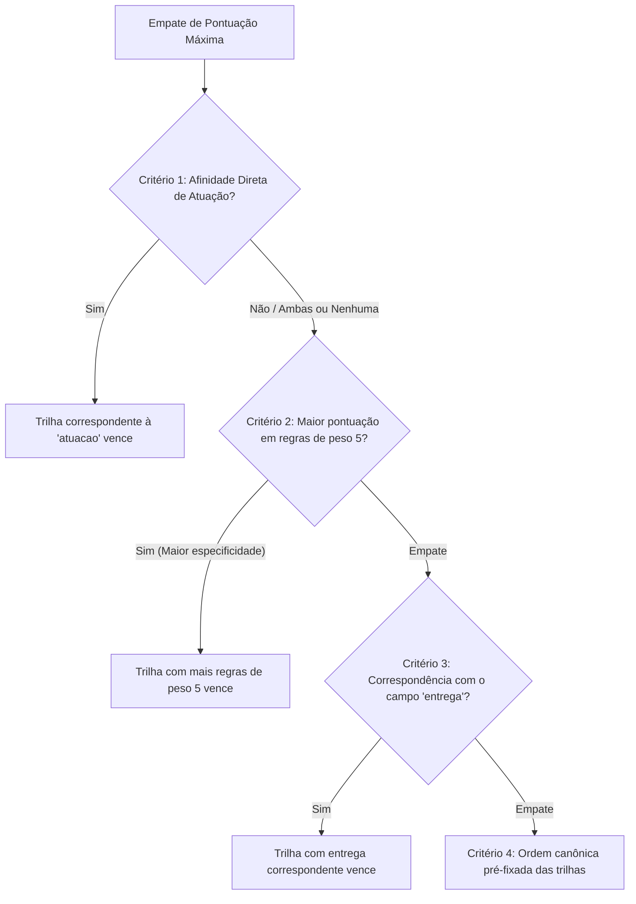

# Matriz de Decisão — Consultor Inteligente de Carreiras em TI

Sistema Especialista baseado em regras de encadeamento para frente (*forward chaining*) desenvolvido para a disciplina de Inteligência Artificial do curso de Ciência da Computação (UNIPAC Barbacena).

---

## 1. Visão Geral do Sistema e Raciocínio de Inferência

O objetivo deste sistema especialista é mapear o perfil, preferências técnicas, estilo de trabalho e maturidade do usuário para recomendar **uma entre 10 trilhas de carreira em Tecnologia da Informação**, justificando formalmente a recomendação por meio das regras disparadas durante a sessão de inferência.

### As 10 Trilhas de Carreira
1. `back_end`: Desenvolvimento Back-end
2. `front_end`: Desenvolvimento Front-end & UI/UX
3. `ciencia_dados`: Ciência de Dados e Machine Learning
4. `eng_dados`: Engenharia de Dados
5. `ciberseguranca`: Cibersegurança
6. `devops`: DevOps & SRE
7. `cloud`: Computação em Nuvem / Cloud Architecture
8. `mobile`: Desenvolvimento Mobile
9. `qa`: Engenharia de Qualidade e Testes
10. `produto`: Gestão de Produtos / Product Management

---

## 2. Matriz de Regras de Produção (R01 a R26)

O conhecimento do domínio é codificado em **26 regras de produção**. Cada regra cruza pelo menos dois campos de fatos coletados, atribuindo uma pontuação de relevância (peso de 1 a 5) à respectiva trilha de carreira.

| ID | Trilha Alvo | Condições (Premissas) | Pontos | Justificativa do Disparo |
|---|---|---|:---:|---|
| **R01** | `back_end` | `atuacao == 'servidores'`  AND `ferramenta IN ('backend_lang', 'python', 'sql')` | 5 | Forte vocação para o núcleo de back-end: construção de APIs e microsserviços integrados a linguagens e bancos corporativos. |
| **R02** | `back_end` | `atuacao == 'algoritmos_logica'`  AND `estetica IN ('baixa', 'media')`  AND `interesse_mobile == 'nao'` | 4 | Perfil focado na lógica pura de programação e processamento de regras de negócio, sem inclinação para camadas visuais ou apps móveis. |
| **R03** | `back_end` | `entrega IN ('produto_final', 'infraestrutura')`  AND `ferramenta == 'backend_lang'` | 3 | Afinidade com stacks de back-end estabelecidas (Java, C#, Go) com objetivo de entregar sistemas transacionais sólidos e escaláveis. |
| **R04** | `front_end` | `atuacao == 'layouts_visuais'`  AND `ferramenta == 'javascript'` | 5 | Núcleo do ecossistema front-end: criação de interfaces visuais interativas utilizando a linguagem dominante do navegador (JavaScript/TypeScript). |
| **R05** | `front_end` | `estetica == 'alta'`  AND `entrega == 'produto_final'`  AND `interesse_mobile == 'nao'` | 4 | Grande sensibilidade visual e foco na experiência de usuário final entregue especificamente na web para navegadores desktop e responsivos. |
| **R06** | `front_end` | `atuacao == 'layouts_visuais'`  AND `terminal IN ('baixo', 'medio')` | 3 | Preferência por design de telas, ergonomia de uso e desenvolvimento de interface, operando com menor necessidade de linhas de comando ou servidores. |
| **R07** | `ciencia_dados` | `foco_dados == 'modelagem'`  AND `matematica == 'alta'` | 5 | Alinhamento essencial para cientista de dados: fundamentação estatística e matemática avançada aliada à experimentação de modelos preditivos e algoritmos de IA. |
| **R08** | `ciencia_dados` | `atuacao == 'dados_brutos'`  AND `ferramenta == 'python'` | 4 | Afinidade prática com análise exploratória e extração de conhecimento a partir de grandes massas de dados usando Python e suas bibliotecas analíticas. |
| **R09** | `ciencia_dados` | `entrega == 'insights_previsoes'`  AND `foco_dados == 'modelagem'` | 4 | Valorização de entregas focadas em predição de comportamento, descobertas estratégicas e aplicação de algoritmos de inteligência de dados. |
| **R10** | `eng_dados` | `foco_dados == 'pipelines'`  AND `atuacao == 'pipelines_dados'` | 5 | Núcleo da Engenharia de Dados: projeto, ingestão e sustentação de esteiras de ETL/ELT distribuídas e repositórios analíticos em escala (Data Lakes / Warehouses). |
| **R11** | `eng_dados` | `entrega == 'dados_confiaveis'`  AND `ferramenta IN ('sql', 'python')` | 4 | Compromisso primordial com a qualidade, governança, integridade e disponibilidade de grandes volumes de dados analíticos para a organização. |
| **R12** | `eng_dados` | `foco_dados == 'pipelines'`  AND `terminal IN ('medio', 'alto')` | 3 | Capacidade de manipular ferramentas de fluxo de dados distribuído que operam nativamente sobre contêineres e ambientes de terminal. |
| **R13** | `ciberseguranca` | `ataque_defesa == 'sim'`  AND `atuacao == 'seguranca'` | 5 | Núcleo de Cibersegurança: paixão evidente por análise de vulnerabilidades, auditorias de segurança e mecanismos de proteção e mitigação cibernética. |
| **R14** | `ciberseguranca` | `entrega == 'seguranca'`  AND `ferramenta == 'linux_redes'` | 4 | Domínio das camadas de sistemas operacionais e protocolos de rede com o objetivo prioritário de blindagem contra ataques e intrusões. |
| **R15** | `ciberseguranca` | `ataque_defesa == 'sim'`  AND `gosta_testar == 'sim'` | 3 | Mentalidade investigativa orientada a testes de estresse defensivo e ofensivo (pentesting), explorando vetores de ataque e brechas lógicas. |
| **R16** | `devops` | `atuacao == 'automacao_deploy'`  AND `terminal == 'alto'` | 5 | Núcleo de DevOps/SRE: automação contínua de esteiras de build, teste e deploy (CI/CD) com controle total via scripts em terminal e contêineres Docker. |
| **R17** | `devops` | `entrega == 'infraestrutura'`  AND `ferramenta == 'linux_redes'` | 4 | Foco na estabilidade de sistemas distribuídos, confiabilidade operacional e observabilidade de serviços em produção suportados por Linux. |
| **R18** | `cloud` | `atuacao == 'arquitetura_nuvem'`  AND `entrega == 'infraestrutura'` | 5 | Núcleo de Cloud Architecture: dimensionamento, provisionamento e governança de soluções escaláveis em provedores hiper-escala (AWS, Azure, GCP). |
| **R19** | `cloud` | `atuacao == 'arquitetura_nuvem'`  AND `terminal IN ('medio', 'alto')` | 4 | Conforto operacional na orquestração de infraestrutura como código (IaC) e ferramentas de nuvem executadas via interface de linha de comando. |
| **R20** | `mobile` | `interesse_mobile == 'sim'`  AND `ferramenta == 'mobile_lang'` | 5 | Núcleo do Desenvolvimento Mobile: domínio ou forte direcionamento para linguagens especializadas (Dart/Flutter, Kotlin, Swift) para ecossistemas móveis. |
| **R21** | `mobile` | `atuacao == 'apps_celular'`  AND `entrega == 'produto_final'` | 5 | Foco direcionado na construção de aplicações finais integradas aos recursos nativos de dispositivos móveis (câmera, sensores, notificações). |
| **R22** | `mobile` | `interesse_mobile == 'sim'`  AND `estetica IN ('media', 'alta')` | 3 | Valorização da fluidez visual, microinterações táteis e adaptação a múltiplos tamanhos de tela características de interfaces de smartphones. |
| **R23** | `qa` | `atuacao == 'testes_qualidade'`  AND `gosta_testar == 'sim'` | 5 | Núcleo de Engenharia de Qualidade: vocação evidente para elaboração de planos de teste, garantia de requisitos e investigação de falhas de software. |
| **R24** | `qa` | `entrega == 'qualidade_confiabilidade'`  AND `gosta_testar == 'sim'` | 4 | Busca sistemática por zero defeitos em produção, automatizando validações ponta a ponta e elevando os padrões de confiabilidade do produto. |
| **R25** | `produto` | `atuacao == 'negocio_produto'`  AND `social == 'alto'` | 5 | Núcleo de Product Management: perfil altamente articulador, que atua na interseção entre tecnologia, necessidades de clientes e metas estratégicas de negócio. |
| **R26** | `produto` | `entrega == 'estrategia_produto'`  AND `social IN ('medio', 'alto')` | 4 | Satisfação atrelada ao sucesso mercadológico do produto digital, priorização assertiva de backlogs e facilitação contínua entre equipes multidisciplinares. |

---

## 3. Análise e Resolução de Pares Confusos

Áreas correlatas na computação frequentemente compartilham preferências superficiais. Abaixo detalha-se como os antecedentes das regras realizam a desambiguação lógica dos pares clássicos:

### 3.1. Cientista de Dados (`ciencia_dados`) vs. Engenheiro de Dados (`eng_dados`)
* **Ponto de convergência aparente:** Ambos lidam intensamente com dados, Python e bancos de dados SQL.
* **Fatores discriminantes:**
  1. `foco_dados`: O valor `'modelagem'` ativa R07 e R09 (Ciência de Dados), enquanto `'pipelines'` ativa R10 e R12 (Engenharia de Dados).
  2. `matematica`: Ciência de Dados pontua massivamente quando a afinidade é `'alta'` (modelos estatísticos, regressões, cálculo e álgebra vetorial). Engenharia de Dados não requer matemática avançada, concentrando-se na robustez arquitetural.
  3. `atuacao` e `entrega`: O cientista de dados busca `atuacao == 'dados_brutos'` e `entrega == 'insights_previsoes'`. O engenheiro de dados busca `atuacao == 'pipelines_dados'` e `entrega == 'dados_confiaveis'`.

### 3.2. DevOps (`devops`) vs. Cloud Architecture (`cloud`) vs. Cibersegurança (`ciberseguranca`)
* **Ponto de convergência aparente:** Todas as três carreiras exigem conforto elevado com `terminal`, sistemas Linux, redes e infraestrutura.
* **Fatores discriminantes:**
  1. `ataque_defesa`: Resposta `'sim'` ativa R13 e R15, direcionando os pontos decisivos para `ciberseguranca`. Se for `'nao'`, a pontuação de segurança não decola.
  2. `atuacao`:
     - Se `atuacao == 'seguranca'`, confirma o viés de Cibersegurança.
     - Se `atuacao == 'automacao_deploy'`, ativa R16 (DevOps / SRE) focando na esteira de integração e entrega contínua (CI/CD).
     - Se `atuacao == 'arquitetura_nuvem'`, ativa R18 e R19 (Cloud Architecture), com foco no desenho e planejamento topológico de serviços gerenciados na nuvem.
  3. `entrega`: `seguranca` isola Cibersegurança; `infraestrutura` pontua tanto Cloud quanto DevOps, mas as regras nucleares de `atuacao` garantem o desempate preciso.

### 3.3. Back-end (`back_end`) vs. Front-end (`front_end`) vs. Mobile (`mobile`)
* **Ponto de convergência aparente:** Construção de aplicações e entrega de `produto_final`.
* **Fatores discriminantes:**
  1. `interesse_mobile`: Resposta `'sim'` aliada a `ferramenta == 'mobile_lang'` ativa R20 e R22, direcionando o peso para `mobile`. Se `'nao'`, mobile é prontamente descartado.
  2. `atuacao`:
     - `servidores` dispara R01 (Back-end).
     - `layouts_visuais` dispara R04 e R06 (Front-end).
     - `apps_celular` dispara R21 (Mobile).
  3. `estetica`: Front-end pontua fortemente com `estetica == 'alta'` (R05). Back-end opera tipicamente com `estetica` baixa ou média (R02). Mobile balanceia a experiência tátil com foco nas bibliotecas de componentes do aparelho.
  4. `ferramenta`: `javascript` reforça Front-end; `backend_lang` (Java, C#, Go) reforça Back-end; `mobile_lang` (Dart, Kotlin, Swift) define Mobile.

### 3.4. QA / Testes (`qa`) vs. Produto (`produto`) vs. Back-end (`back_end`)
* **Ponto de convergência aparente:** Todos se preocupam com a qualidade e o funcionamento correto das regras do produto digital.
* **Fatores discriminantes:**
  1. `social`: Gestão de Produto exige alto relacionamento interpessoal (`social == 'alto'` em R25). QA e Back-end mantêm foco técnico primário com nível social moderado ou focado no time técnico.
  2. `gosta_testar`: Resposta `'sim'` é a premissa chave de R23, R24 e R15. Para `qa`, `gosta_testar == 'sim'` associado a `atuacao == 'testes_qualidade'` consolida a pontuação máxima. Desenvolvedores backend preferem construir funcionalidades a auditar falhas alheias.
  3. `entrega`:
     - `qualidade_confiabilidade` consolida QA (R24).
     - `estrategia_produto` consolida Gestão de Produtos (R26).
     - `produto_final` ou `infraestrutura` consolida Back-end (R03).

---

## 4. Política Determinística de Desempate

O motor de inferência acumula os pontos gerados pelas regras disparadas em um dicionário de contadores por trilha. Ao final do ciclo de inferência (*halt* do motor), caso duas ou mais trilhas atinjam **exatamente a mesma pontuação máxima**, o sistema aplica os seguintes critérios hierárquicos e determinísticos:

### Regras Detalhadas da Cascata de Desempate:

1. **Critério 1 (Âncora de Atuação Primária):**
   Verifica-se se a resposta informada no campo `atuacao` corresponde à âncora direta de uma das trilhas empatadas:
   - `servidores` ou `algoritmos_logica` $\rightarrow$ favorece `back_end`
   - `layouts_visuais` $\rightarrow$ favorece `front_end`
   - `dados_brutos` $\rightarrow$ favorece `ciencia_dados`
   - `pipelines_dados` $\rightarrow$ favorece `eng_dados`
   - `seguranca` $\rightarrow$ favorece `ciberseguranca`
   - `automacao_deploy` $\rightarrow$ favorece `devops`
   - `arquitetura_nuvem` $\rightarrow$ favorece `cloud`
   - `apps_celular` $\rightarrow$ favorece `mobile`
   - `testes_qualidade` $\rightarrow$ favorece `qa`
   - `negocio_produto` $\rightarrow$ favorece `produto`

2. **Critério 2 (Maior Grau de Especificidade / Peso das Regras Disparadas):**
   Se o critério anterior não desempatar, vence a trilha que tiver obtido mais pontos a partir de regras com peso máximo (**peso 5**), privilegiando a precisão das evidências coletadas.

3. **Critério 3 (Âncora de Entrega de Valor):**
   Verifica-se se a resposta no campo `entrega` é o valor típico primário da trilha:
   - `seguranca` $\rightarrow$ `ciberseguranca`
   - `insights_previsoes` $\rightarrow$ `ciencia_dados`
   - `dados_confiaveis` $\rightarrow$ `eng_dados`
   - `qualidade_confiabilidade` $\rightarrow$ `qa`
   - `estrategia_produto` $\rightarrow$ `produto`
   - `produto_final` $\rightarrow$ `front_end` / `mobile` / `back_end`
   - `infraestrutura` $\rightarrow$ `devops` / `cloud`

4. **Critério 4 (Ordem Canônica Determinística):**
   Persistindo o empate em todas as camadas anteriores, aplica-se a ordem estável de catálogo pré-definida no dicionário `TRILHAS`:
   `back_end` > `front_end` > `ciencia_dados` > `eng_dados` > `ciberseguranca` > `devops` > `cloud` > `mobile` > `qa` > `produto`.
